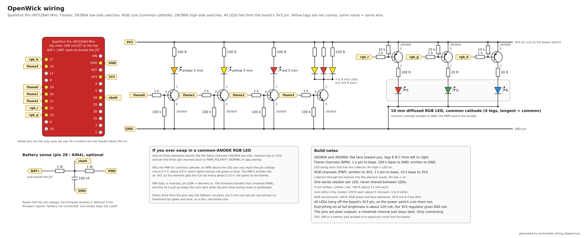

# OpenWick

An open, Bluetooth-controlled flickering candle for a Halloween pumpkin:
Zephyr RTOS in C on a SparkFun Pro nRF52840 Mini, a handful of warm LEDs and
one RGB LED switched through 2N3904/2N3906 transistors, powered from a single
LiPo cell. The board advertises as "Pumpkin Candle".

Phone-side control (power, brightness, flicker pattern, colour) is a custom
BLE GATT service, testable with nRF Connect for Mobile. Also in the tree: a
Zephyr board definition for the SparkFun Mini and a rebuilt UF2 bootloader
for it, with a recovery script for boards whose bootloader was erased.

## Hardware

| Header pin | Signal | What                    | Peripheral |
|-----------:|--------|-------------------------|------------|
| P0.19      | flame0 | amber 5 mm              | PWM0 ch0   |
| P0.20      | flame1 | yellow 5 mm             | PWM0 ch1   |
| P0.21      | flame2 | red 5 mm                | PWM0 ch2   |
| P0.15      | flame3 | mini LED cluster        | PWM0 ch3   |
| P0.22      | rgb_r  | RGB LED red             | PWM1 ch0   |
| P0.23      | rgb_g  | RGB LED green           | PWM1 ch1   |
| P0.17      | rgb_b  | RGB LED blue            | PWM1 ch2   |
| P0.28      | vbatt  | battery divider (AIN4)  | SAADC      |
| P0.07      | led0   | onboard blue LED        | GPIO       |
| P0.13      | sw0    | onboard button          | GPIO       |



The full schematic is [`docs/wiring.svg`](docs/wiring.svg) (PNG above),
generated by `tools/make_wiring_diagram.py`. Parts for the whole thing:

| Qty   | Part                                   | Where                              |
|-------|----------------------------------------|------------------------------------|
| 4     | 2N3904 (NPN)                           | flame channels, low side           |
| 3     | 2N3906 (PNP)                           | RGB channels, high side            |
| 7     | 1 k                                    | pin to base                        |
| 4     | 100 k                                  | NPN base to GND                    |
| 3     | 10 k                                   | PNP base to 3V3                    |
| 4     | 100 R                                  | amber, yellow, red 5 mm, RGB red   |
| 2     | 20 R                                   | RGB green, RGB blue                |
| 3 - 6 | 220 R                                  | one per mini LED in the cluster    |
| 3     | 5 mm LED: amber, yellow, red           | flame0 - flame2                    |
| 3 - 6 | 3 mm LED, yellow and red mixed         | flame3 cluster, wired in parallel  |
| 1     | 10 mm diffused RGB LED, common cathode | rgb_r / rgb_g / rgb_b              |
| 2 + 1 | 1 M, 1 M, 100 nF (optional)            | battery divider on pin 28          |

The flame channels are low-side switches, LEDs fed from the board's 3V3 pin:

```
           3V3
            |
          [100R]     one resistor per LED, never shared
            |
           LED       anode toward 3V3
            |
            C
GPIO --[1k]-- B   2N3904 (flat face toward you, legs E-B-C left to right)
            E     plus 100k from B to GND so the LED stays off during reset
            |
           GND
```

The RGB LED is common cathode, so each element is switched on the high side
by a 2N3906 and the firmware drives those three pins inverted (pin low = on):

```
           3V3 ----+
            |      |
            E     [10k]   keeps the element off while the pin floats
GPIO --[1k]-- B    |      (reset, bootloader)
            C -----+
            |
         [100R red / 20R green or blue]
            |
        element anode
            |
      common cathode ---- GND
```

Series resistors: 100 R for the 5 mm flames and the RGB red element, 20 R
for the RGB green and blue elements (10 R if they look weak), 220 R per
mini LED in the cluster.

Battery sense: two 1 M resistors in series from the battery "+" pad (next to
the JST socket) to GND, midpoint to P0.28, 100 nF from midpoint to GND.

The wiring lives in `app.overlay`; the board itself is described in
`boards/sparkfun/pro_nrf52840_mini/`.

## Building

Builds use the nRF Connect SDK v3.3.0 bundle already installed under
`~/ncs` (no global `west` needed):

```
./build.sh          # incremental
./build.sh -p       # pristine
```

Output: `build/zephyr/zephyr.uf2` (and `zephyr.hex` for SWD flashing).

## Flashing

**UF2 (no extra hardware):** double-tap the RESET button, or type
`candle dfu` on the USB console. The blue LED pulses and a `NRF52BOOT` USB
drive appears. Then:

```
./flash.sh
```

`INFO_UF2.TXT` on that drive names the bootloader's SoftDevice. The board
target `sparkfun_pro_nrf52840_mini/nrf52840/uf2` assumes S140 v6.1.1
(application at 0x26000). If the file reports a 7.x SoftDevice, switch the
include in `sparkfun_pro_nrf52840_mini_nrf52840_uf2.dts` to
`nrf52840_partition_uf2_sdv7.dtsi`.

**SWD (nRF52840 DK as the programmer):** wire the DK's Debug Out header
(P20: SWD IO, SWD CLK, GND, VTG to the SparkFun 3V3, GND DETECT to GND) to the
SWDIO/SWDCLK pads on the bottom of the SparkFun board, then:

```
cd ~/ncs/v3.3.0 && nrfutil sdk-manager toolchain launch --ncs-version v3.3.0 -- \
    west flash -d <path to this repo>/build --runner jlink
```

This writes only the application region, so the UF2 bootloader survives.
Never flash the plain `sparkfun_pro_nrf52840_mini/nrf52840` target over SWD
unless you mean to erase the bootloader.

## Bootloader recovery

Symptom: double-tapping RESET does nothing and no `NRF52BOOT` drive appears.
Any image flashed over SWD at address 0 (an OpenThread RCP, a plain Zephyr
build, an nRF5 SDK example) replaces the MBR that chains into the bootloader,
so the bootloader can no longer run even if its bytes survived at 0xF4000.

The fix needs SWD once. Wire the DK's P20 Debug Out header to the SparkFun
board: `VTG` to 3V3, `GND DETECT` to GND, `GND` to GND, `SWD IO` to SWDIO,
`SWD CLK` to SWDCLK. The SparkFun board exposes SWDIO/SWDCLK on the J4 pads
and on the unpopulated 2x5 Cortex debug footprint (pin 2 SWDIO, pin 4 SWDCLK)
on its underside. Power the SparkFun board from its own USB. Then:

```
tools/restore_bootloader.sh --expect-usb-serial <serial the old firmware showed on USB>
```

The script checks the chip identity over SWD, dumps the old flash to
`backups/`, then erases, programs and verifies the hex in `bootloader/`
(see `bootloader/README.md` for how it was built). After the reset the board
sits in bootloader mode with the drive mounted, ready for `./flash.sh`.

## Controls

| Setting    | Range                 | Meaning                                   |
|------------|-----------------------|-------------------------------------------|
| power      | 0 / 1                 | light off / on                            |
| brightness | 0-100 %               | overall level                             |
| mode       | 0-7                   | see below                                 |
| speed      | 0-100                 | flicker tempo                             |
| intensity  | 0-100                 | flicker depth and gust strength           |
| colour     | R, G, B (0-255 each)  | colour of the RGB core                    |

Modes: 0 steady, 1 calm, 2 normal, 3 windy, 4 ember, 5 storm (lightning),
6 colour cycle, 7 breathe.

Settings persist in the Storage partition and survive power cycles. The
board's button toggles the light with a short press and steps to the next
mode with a long press (1.5 s). The blue LED blinks once every two seconds
while advertising and twice while a phone is connected.

Below 3.30 V on the battery divider the light is forced off until the cell
recovers above 3.55 V; an unwired divider is reported as "not connected".

## Bluetooth service

The device advertises as "Pumpkin Candle" with the Candle service UUID in
the scan response. Characteristics (base `a3c1XXXX-7f6e-4b1a-9c2d-5e8f0a1b2c3d`,
all readable, writable and notifiable unless noted):

| XXXX | Characteristic | Value                         |
|------|----------------|-------------------------------|
| 0001 | service        |                               |
| 0002 | Power          | uint8, 0 or 1                 |
| 0003 | Brightness     | uint8, 0-100                  |
| 0004 | Mode           | uint8, 0-7                    |
| 0005 | Speed          | uint8, 0-100                  |
| 0006 | Intensity      | uint8, 0-100                  |
| 0007 | Colour         | 3 bytes R, G, B               |
| 0008 | Battery mV     | uint16 LE, read/notify only   |

Each characteristic carries a user description (read the "Characteristic
User Description" descriptor to see it). Generic tools list the service as
"Unknown Service" because the UUID is ours. The standard Battery Service
(percent) and Device Information Service are also present. Out-of-range
writes are rejected with "value not allowed".

Phones cache a device's service table. iOS in particular keeps showing the
old list after a firmware update until Bluetooth is switched off and on in
Settings (nRF Connect for Android has "Refresh services"). The firmware
exposes the GATT Database Hash so well-behaved clients notice changes on
their own.

Do not enable `CONFIG_BT_SHELL` on this board: it prints from the Bluetooth
stack's thread straight into the USB console, which only drains while a
terminal holds the port open, so the first connection with no terminal
attached freezes the stack. Everything in this firmware logs through the
non-blocking log path instead.

## Shell

The USB console runs a Zephyr shell with a `candle` command group:

```
candle status                 settings, output levels, battery, BLE state
candle on | off | toggle
candle bright <0-100>
candle mode <0-7|name>        candle modes   lists them
candle speed <0-100>
candle intensity <0-100>
candle rgb <r> <g> <b>
candle balance <r> <g> <b>    RGB white balance in %, not saved
candle dfu                    reboot into the UF2 bootloader (no button needed)
```

## Console

The uf2 build routes the Zephyr shell and the logs to the board's own USB
serial port, which appears as `/dev/serial/by-id/usb-Zephyr_Project_*`
(usually `/dev/ttyACM<n>`). Open it with:

```
./console.sh                      # finds the port, runs tio/picocom/screen
screen /dev/ttyACM2 115200        # by hand; leave with Ctrl-A, K, y
```

Press Enter for the `candle:~$` prompt. `help` lists everything, `candle`
alone lists its subcommands, and Tab completes names. Log lines keep
arriving between commands; that is normal. Logging starts about four
seconds after boot to give the terminal time to attach.

The port is created `root:dialout` by default. If opening it fails with
"Permission denied", install the udev rule in `tools/99-zephyr-usb.rules`
(the file header has the two commands) or add yourself to the `dialout`
group and log in again.

## License

Apache-2.0, see `LICENSE`. The `bootloader/` directory is the exception: its
board files are MIT like the Adafruit bootloader they belong to, and its
binaries bundle Nordic's S140 SoftDevice under Nordic's own license. Details
in `bootloader/README.md`.
